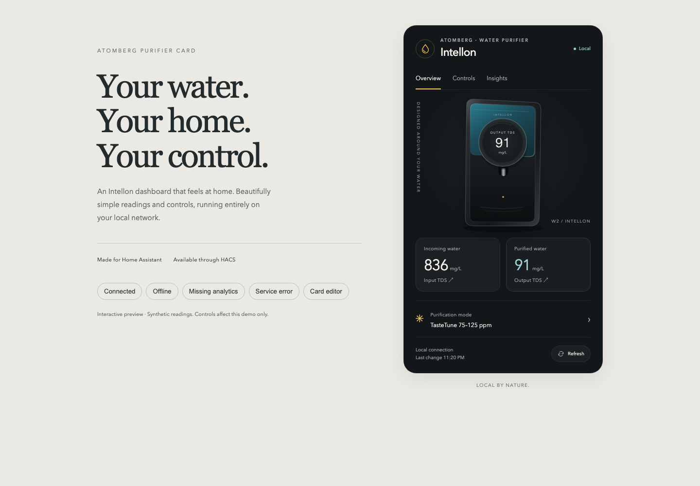
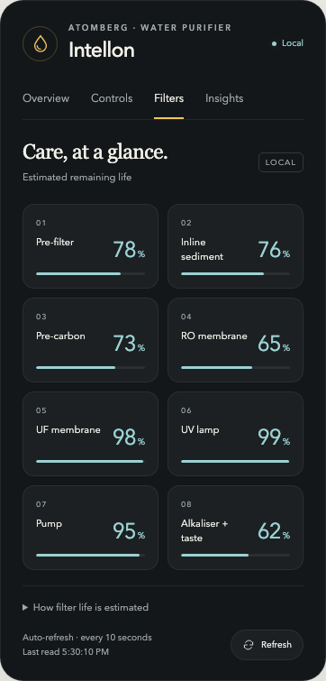

# Atomberg Purifier Card

Your Intellon, at home in Home Assistant. A dark dashboard card inspired by the Atomberg app, with a custom purifier illustration, clear water readings, and controls that work over your local network.



## What you get

- **Overview:** input/output TDS, current purification mode, local connection status and refresh.
- **Controls:** purification mode, fallback mode, TDS threshold, display sleep and sleep schedule.
- **Filters:** eight remaining-life estimates, with progress bars and Home Assistant history.
- **Insights:** lifetime water, estimated water saved and runtime, clearly labelled **Beta**.
- A visual card editor, automatic device discovery, phone-friendly layout and keyboard controls.
- No cloud account, CDN, remote fonts, app assets or external image requests. The artwork is bundled with the card.

This is an independent community project, not an official Atomberg app. It is a **HACS custom repository**, not yet part of the default HACS catalog.

## 1. Install the local integration first

The card displays and controls the entities from [Atomberg Water Purifier Local](https://github.com/dtechterminal/ha-atomberg-water-purifier-local). Follow that repository's setup instructions first.

Use integration **0.3.0 or newer** for filter life and automatic readings every 10 seconds. Older versions still work; readings they do not provide show a dash.

## 2. Install this card with HACS

1. Open **HACS** in Home Assistant.
2. Open **⋮ → Custom repositories**.
3. Paste `https://github.com/dtechterminal/atomberg-purifier-card`.
4. Choose **Dashboard**, then **Add**.
5. Find **Atomberg Purifier Card**, download it, then reload your browser when prompted.

You only add the repository once. HACS handles future updates.

## 3. Put it on your dashboard

1. Open your Home Assistant dashboard and choose **Edit dashboard**.
2. Choose **Add card** and search for **Atomberg Purifier**.
3. With one purifier, it finds the device automatically. With several, choose one in the card editor.
4. Give it a title if you like, then **Save**.

You do not need to enter an IP address, password or API key. Renaming your entities is supported: the card matches them using Home Assistant's device registry, not a guessed name.

**Can't see the card?** Reload the browser. Under **Settings → Dashboards → ⋮ → Resources**, check that this JavaScript module exists:

```text
/hacsfiles/atomberg-purifier-card/atomberg-purifier-card.js
```

Resource management may require **Advanced mode** in your Home Assistant profile. Add the resource only if HACS has not already registered it.

## Using it

- Tap either TDS reading to open its Home Assistant history.
- Open **Controls** to change settings. Changes are confirmed by the integration; failures are shown on the card.
- Enable **Sleep schedule** before editing its times. Times use Home Assistant's configured time zone.
- Readings refresh automatically every **10 seconds**. The bottom of the card shows the last successful read time. Tap **Refresh** to check immediately.
- An unavailable reading shows **—**. Controls are disabled when the purifier is unavailable.

### About Insights and filter health

The beta analytics match the values displayed by the W2 app, but comparison through a complete refill cycle is still pending. They are lifetime device counters, not a calibrated measure of what you just dispensed. They may change when the tank refills, rather than when you draw a glass.

Water saved uses [Atomberg's estimate](https://developer.atomberg-iot.com/reference/get-device-analytics) against a 25% recovery purifier. It is not a direct measurement of water sent to drain. Long-term statistics for these beta sensors are intentionally withheld while counter/reset behavior is checked; ordinary Home Assistant history is available.

Open **Filters** for pre-filter, inline sediment, pre-carbon, RO, UF, UV lamp, pump and alkaliser life. Tap a component to see its Home Assistant history. These estimates use the purifier’s local water/runtime counters and Atomberg’s capacity formulas. They assume all components are original; replacement history and the app’s flow-performance adjustments are not included. If you have replaced a component, its estimate will be inaccurate. [How the estimates work](https://github.com/dtechterminal/ha-atomberg-water-purifier-local/blob/main/docs/filter-life.md).

Daily cloud charts are unavailable. TDS and filter-life estimates do not establish drinking-water safety.



## Optional YAML

The visual editor is the easiest route. This also works:

```yaml
type: custom:atomberg-purifier-card
title: Kitchen water
show_analytics: true
```

For multiple purifiers, add `entity:` using that purifier's **Input TDS** entity. The other entities are found automatically.

## Manual installation

1. Download `atomberg-purifier-card.js` from the [latest release](https://github.com/dtechterminal/atomberg-purifier-card/releases/latest).
2. Put it in Home Assistant's `config/www/` directory.
3. Add `/local/atomberg-purifier-card.js` as a **JavaScript module** under dashboard Resources.
4. Reload your browser and add the card as described above.

## Development

```sh
npm ci
npm run build
npm test
npx playwright install chromium
npm run test:browser
npm run dev
```

Open `http://127.0.0.1:8766/demo/`. The interactive preview uses synthetic readings and never calls a real purifier. Tests cover device selection, renamed entities, each service type, failed commands, unavailable devices, filter estimates, fresh read timestamps, visual editing and mobile layouts.

The release is one self-contained JavaScript module. The original vector purifier illustration is defined in `src/art.js`. No reverse-engineered app binaries, screenshots, credentials or private device recordings are included.

Built using Home Assistant's [custom card API](https://contributors.home-assistant.io/frontend/custom-ui/card/) and packaged according to [HACS dashboard requirements](https://www.hacs.xyz/docs/publish/plugin/).

## Help

[Open an issue](https://github.com/dtechterminal/atomberg-purifier-card/issues) with the card version, integration version and what happened. Remove private details from screenshots. Never include access tokens or account passwords.
